<p align="center">
  
</p>

<h1 align="center">TelecomHand</h1>

<p align="center">
  Votre téléphone Android devient la télécommande de votre PC Windows, de votre machine Linux<br>
  ou de votre TV maison <b>RaspyTV</b> sur Raspberry Pi.
</p>

<p align="center">
  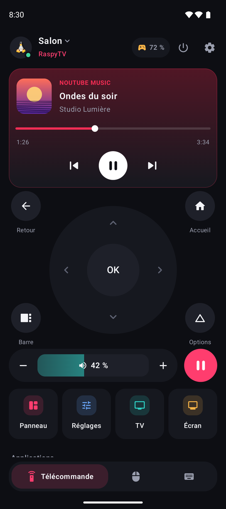
  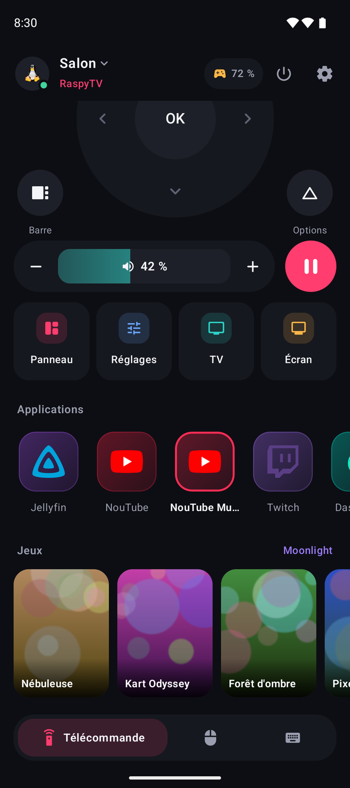
  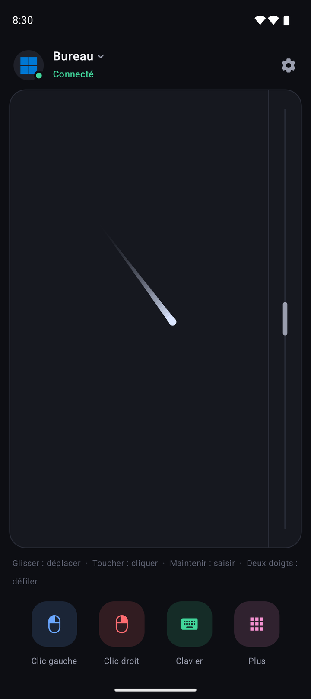
</p>

## Télécharger

| Plateforme | Fichier |
| --- | --- |
| Android | [TelecomHand-Android-v1.10.2.apk](https://github.com/0x80070006/TelecomHand/releases/download/v1.10.2/TelecomHand-Android-v1.10.2.apk) |
| Raspberry Pi | [TelecomHand-RaspberryPi-v1.10.0.tar.gz](https://github.com/0x80070006/TelecomHand/releases/download/v1.10.0/TelecomHand-RaspberryPi-v1.10.0.tar.gz) |
| Windows x64 | [TelecomHand-Windows-x64-v1.9.0.zip](https://github.com/0x80070006/TelecomHand/releases/download/v1.9.0/TelecomHand-Windows-x64-v1.9.0.zip) |

[Toutes les releases](https://github.com/0x80070006/TelecomHand/releases) · [Historique des versions](CHANGELOG.md)

L'APK est signé avec une clé de débogage : Android demande d'autoriser l'installation depuis cette source.

## Comment ça marche

TelecomHand a deux parties :

1. **L'application Android**, que vous tenez en main.
2. **Un agent**, petit programme Python installé sur la machine à piloter (PC Windows, Linux ou Raspberry Pi). Il reçoit les commandes du téléphone et les exécute : déplacer la souris, taper du texte, changer le volume…

Le téléphone et la machine doivent être sur le même réseau privé : votre Wi-Fi, ou un réseau Tailscale pour piloter à distance. L'agent n'accepte que les appareils qui connaissent son **code d'accès**, créé au hasard à l'installation.

L'application s'adapte à la machine : si l'agent tourne sur un Raspberry Pi équipé de RaspyTV, elle bascule d'elle-même en **mode RaspyTV**. Sinon, elle affiche le **mode classique**, pavé tactile et clavier.

---

## Mode RaspyTV

RaspyTV est une interface de TV maison pour Raspberry Pi (applications vidéo, musique, photos, jeux en streaming). Dès que l'application s'y connecte, elle affiche une vraie télécommande. Aucun réglage n'est nécessaire.

<p align="center">
  
</p>

### La télécommande

- **Croix directionnelle et OK** : on se déplace de tuile en tuile comme avec une télécommande de TV. Maintenez une direction pour faire défiler une longue liste sans tapoter. Chaque appui vibre légèrement.
- **Retour** et **Accueil** : les deux boutons du haut.
- **Barre** : déploie la barre latérale de RaspyTV.
- **Options (△)** : commandes du lecteur pendant une vidéo, recherche sinon.
- **Panneau** : ouvre sur la TV le panneau rapide (lecture, son, manette), le même que l'appui long sur PS de la manette.
- **Réglages** : ouvre les paramètres de RaspyTV.

En haut, la pastille indique la batterie de la manette DualShock 4 connectée au Pi. Le bouton ⏻ ouvre l'alimentation.

### Lecture en cours

Quand une vidéo ou une musique joue, une carte apparaît en haut avec la jaquette, le titre et l'application. La barre se glisse pour avancer ou reculer ; précédent, lecture/pause et suivant agissent directement dans RaspyTV. La couleur de la carte reprend celle de l'application.

### Volume

La jauge centrale se **glisse** pour régler le volume d'un geste ; **− / +** le changent par crans de 5 %. Un toucher sur la jauge coupe le son. Le réglage passe par RaspyTV : l'indicateur de volume s'affiche aussi sur la TV. Le gros bouton rose met en pause ou relance ce qui joue.

### Sortie audio et casque Bluetooth

<p align="center">
  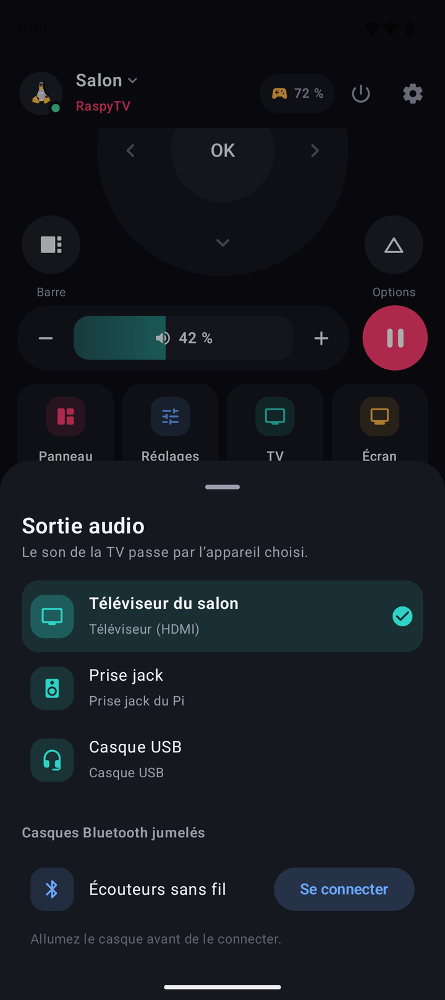
</p>

Le bouton de son (ici « TV ») ouvre la liste des sorties : téléviseur en HDMI, prise jack du Pi, casque USB… La sortie active est cochée. Les casques Bluetooth déjà jumelés au Pi apparaissent en dessous : **Se connecter** les relie et y bascule le son.

### Applications et jeux

<p align="center">
  
</p>

Plus bas, les applications de RaspyTV, à leurs couleurs ; celle qui est ouverte est entourée. Un toucher l'ouvre sur la TV. En dessous, les jeux de votre PC disponibles en streaming via **Moonlight**, avec leur jaquette.

### Alimentation

<p align="center">
  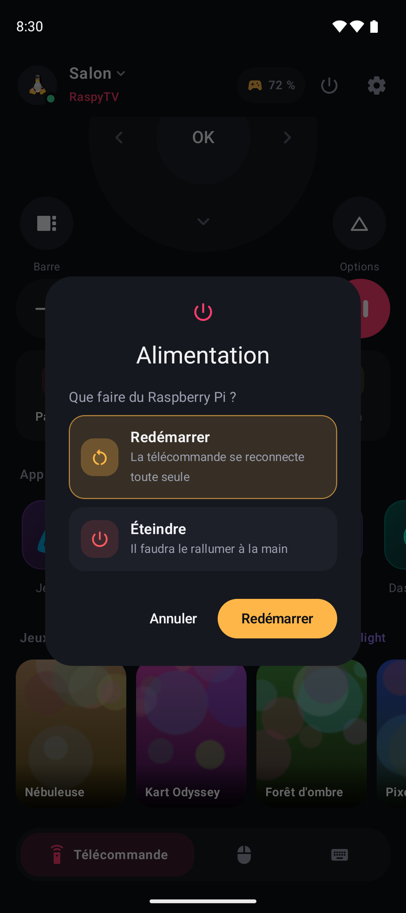
</p>

Redémarrer ou éteindre le Raspberry Pi se fait **en deux temps** : on choisit, puis on confirme. Un toucher égaré n'éteint rien. Après un redémarrage, la télécommande se reconnecte seule.

### Souris et clavier

<p align="center">
  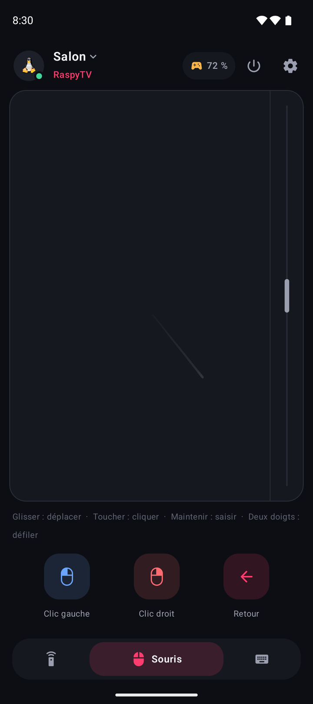
  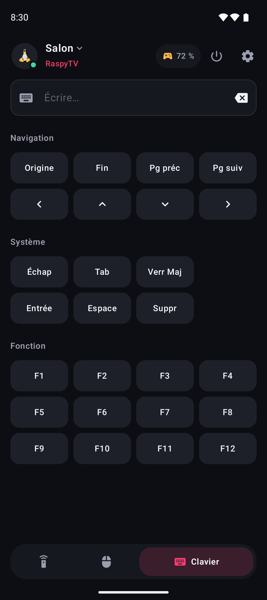
</p>

Les onglets du bas donnent accès au **pavé tactile** (pour un site web qui ne se pilote pas à la croix) et au **clavier** (recherche, identifiants, touches spéciales).

---

## Mode classique (Windows, Linux)

<p align="center">
  
  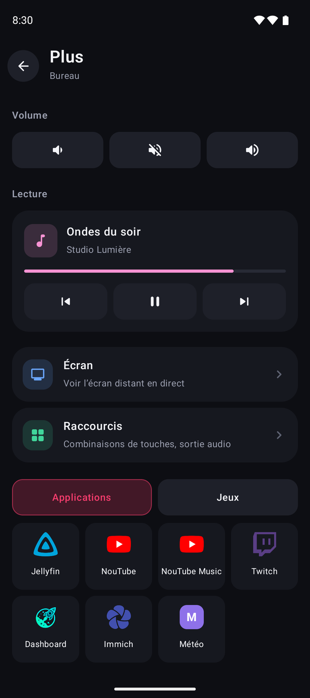
  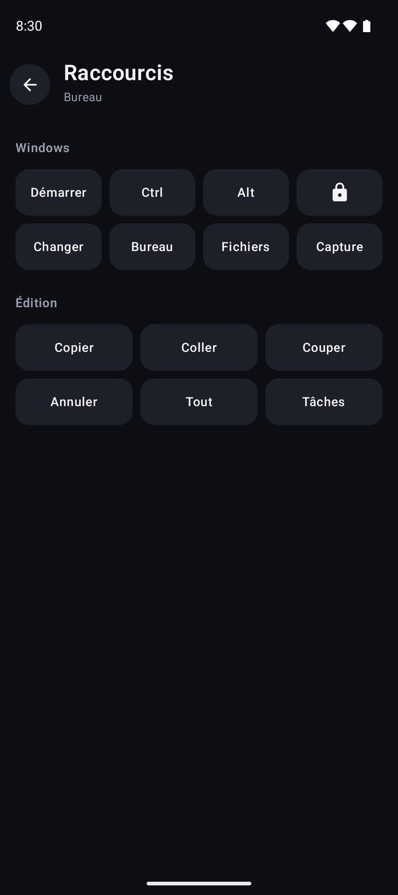
</p>

### Pavé tactile

| Geste | Effet |
| --- | --- |
| Glisser un doigt | Déplacer le pointeur |
| Toucher | Clic gauche |
| Maintenir puis glisser | Glisser-déposer |
| Deux doigts | Défiler |
| Rail à droite | Défiler : lent près du centre, rapide en bout de course |

Les boutons du bas : clic gauche, clic droit, clavier et **Plus**.

### Plus

Volume, lecture en cours (précédent, pause, suivant), lanceur d'applications, et l'accès à :

- **Écran** : l'aperçu en direct de l'écran distant ;
- **Raccourcis** : sur Windows, Démarrer, Ctrl et Alt maintenus, verrouillage, changement de fenêtre, bureau, capture, copier/coller… ; sur Linux, le choix de la sortie audio.

<p align="center">
  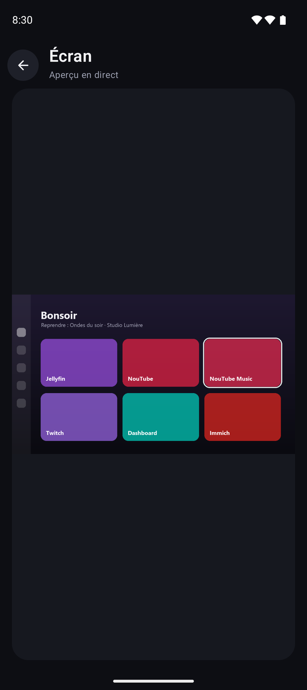
</p>

---

## Ajouter un appareil

<p align="center">
  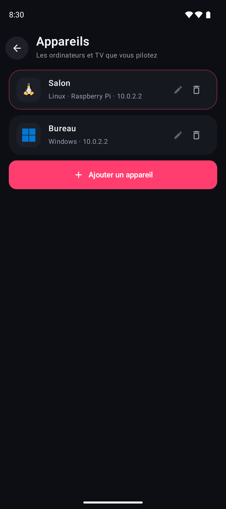
  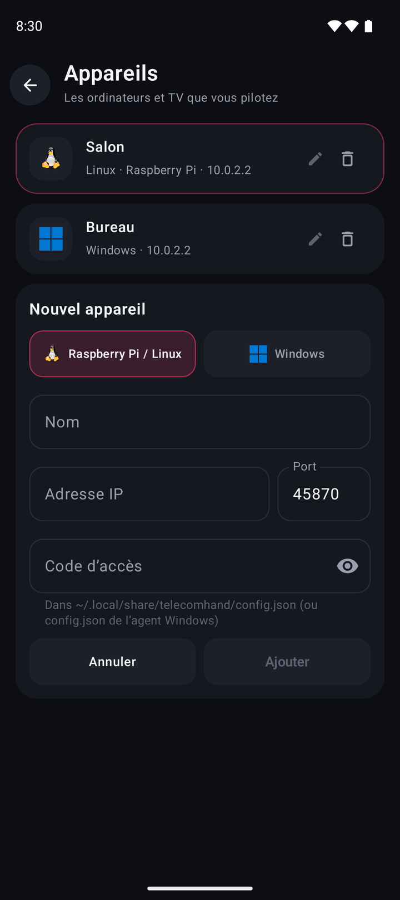
</p>

1. Installez l'agent sur la machine à piloter (voir ci-dessous). À la fin, il affiche son **adresse IP**.
2. Dans l'application, touchez ⚙ puis **Ajouter un appareil**.
3. Choisissez le système, donnez un nom, saisissez l'adresse IP et le **code d'accès**. Gardez le port `45870`.

Le code d'accès se trouve dans le fichier `config.json` de l'agent :

- Raspberry Pi / Linux : `~/.local/share/telecomhand/config.json` ;
- Windows : `config.json`, à côté de l'agent.

Vous pouvez enregistrer plusieurs appareils et passer de l'un à l'autre en touchant le nom en haut de l'écran.

## Installer l'agent

### Raspberry Pi (et RaspyTV)

Téléchargez l'archive Raspberry Pi, puis :

```bash
tar -xzf TelecomHand-RaspberryPi-v1.10.0.tar.gz
cd client/raspberry-pi
chmod +x install.sh
./install.sh
```

L'installateur met en place le service `telecomhand`, qui démarre avec le Pi, et le service `telecomhand-gamepad`. Fonctionne sous Wayland (labwc) et X11. Détails et diagnostic : [client/raspberry-pi/LISEZ-MOI.md](client/raspberry-pi/LISEZ-MOI.md).

**Manette DualShock 4 :** le service `telecomhand-gamepad` transforme une manette PS4 jumelée en Bluetooth en télécommande de RaspyTV : croix pour naviguer, ✕ pour valider, PS pour l'accueil, PS maintenu pour le panneau rapide, L1/R1 pour le volume. Pendant un jeu Moonlight, la manette redevient une manette de jeu. La table complète des boutons est dans le LISEZ-MOI.

### Windows

Décompressez l'archive Windows et lancez `Installer-service-Windows.cmd` et acceptez la demande UAC (démarrage avec Windows), ou `TelecomHand-Windows.exe` pour un essai ; au premier lancement, n'autorisez que les « Réseaux privés ». Voir [client/windows/LISEZ-MOI.txt](client/windows/LISEZ-MOI.txt).

## Sécurité et confidentialité

- Le code d'accès est **aléatoire** et créé à la première installation. Les agents refusent l'ancien code par défaut `telecomhand`. Si vous mettez à jour un très vieil agent, remplacez-le par un code unique d'au moins 16 caractères.
- Le trafic n'est **pas chiffré** : n'exposez jamais les ports `45870` et `45871` sur Internet. Pour piloter à distance, passez par un réseau privé comme Tailscale.
- Le code d'accès, les fichiers `config.json` et toute donnée personnelle restent hors de Git (voir `.gitignore`).
- Les captures de ce README ont été faites sur un émulateur, avec un agent de démonstration et des données fictives (morceau, jeux, appareils).

## Construire depuis les sources

| Composant | Technologie | Dossier |
| --- | --- | --- |
| Application Android | Kotlin, Jetpack Compose, Material 3, Coil | `app/` |
| Agent (Windows, Linux, Raspberry Pi) | Python 3 | `client/` |
| Service manette DualShock 4 | Python 3, evdev, GTK layer-shell | `client/raspberry-pi/` |

Application Android, avec le SDK Android et un JDK 17 :

```bash
./gradlew assembleDebug
```

L'APK est produit dans `app/build/outputs/apk/debug/` (sous Windows : `gradlew.bat`).

Agent : `pip install -r client/requirements.txt`, puis `python client/telecomhand_client.py`. Pour lister les jeux Moonlight sur le Pi, définissez `TELECOMHAND_MOONLIGHT_HOST` avec l'adresse de votre serveur Sunshine. Aucune adresse personnelle n'est intégrée au code.

<details>
<summary>Protocole (pour les curieux)</summary>

L'application envoie des lignes JSON sur le port TCP `45870`, chacune avec le code d'accès, après un `{"type": "hello"}` qui renvoie la version du protocole (5 depuis la v1.10). Le port `45871` sert en HTTP l'aperçu d'écran et l'état de la machine.

| Commandes | Rôle |
| --- | --- |
| `move`, `click`, `scroll`, `button_down`, `button_up` | Souris |
| `key`, `text`, `hotkey`, `key_down`, `key_up` | Clavier |
| `volume`, `media_control`, `audio_output` | Son et lecture |
| `launch_app`, `launch_game` | Lanceur |
| `tv`, `tv_media`, `tv_volume`, `system_power` | RaspyTV (protocole 5) |

| Pages HTTP | Contenu |
| --- | --- |
| `/screen.jpg` | Aperçu de l'écran |
| `/remote-state.json` | Applications, jeux, lecture |
| `/tv-state.json` | État RaspyTV : lecture, volume, sorties audio, manette |
| `/tv-art`, `/app-icon`, `/game-image` | Jaquette, icônes, jaquettes de jeux |

</details>

## Licence

Code sous licence MIT : [LICENSE](LICENSE). Les logos d'applications et composants tiers restent la propriété de leurs auteurs.
